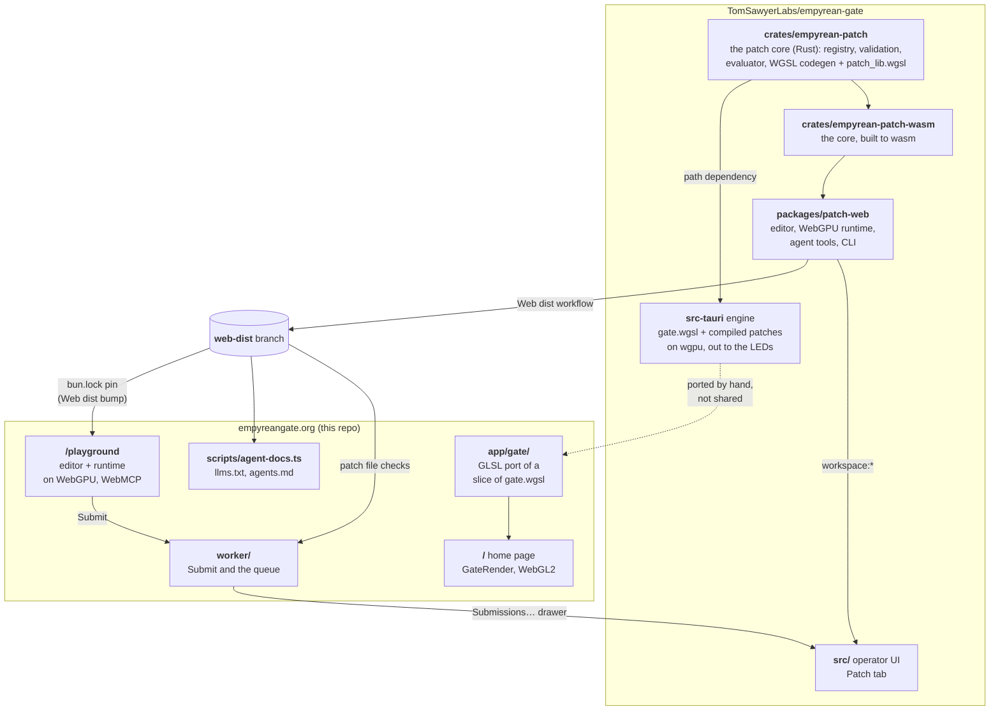

# empyreangate.org

The website for [The Empyrean Gate](https://empyreangate.org), the Entheos
community's ring of light over a dance floor: sixty-four spokes of LEDs, a
gateway, and a fire beneath it. The gate's own software lives at
[TomSawyerLabs/empyrean-gate](https://github.com/TomSawyerLabs/empyrean-gate).

## Stack

Built from [cinderblock/ssg-base](https://github.com/cinderblock/ssg-base):
React 19 + React Router 8, Vite, TypeScript, Bun, Playwright, oxfmt + lefthook.
Fully prerendered. Two pieces of live code: the WebGL render of the array on the
home page, and the [pattern playground](#the-pattern-playground). The only
server code is the small `/api/` Worker (`worker/index.ts`): the playground's
Submit, the queue it feeds, the crew's notifications, whether the gate is
[live](#the-live-gate), and hearing about
[failures in visitors' browsers](#when-something-breaks).

## Getting started

```sh
bun install
bun run dev
```

| Script                          | Description                                                                |
| ------------------------------- | -------------------------------------------------------------------------- |
| `bun run dev`                   | Dev server on :5173                                                        |
| `bun run build`                 | Prerender to `build/client`, then emit 404.html + sitemap                  |
| `bun run preview`               | Serve the built site on :4180                                              |
| `bun run test`                  | Playwright, against a fresh build (not the dev server)                     |
| `bun run test:unit`             | Bun unit tests: render engine, build context                               |
| `bun run test:gpu`              | The playground tests that need WebGPU, in the installed Chrome (headless)  |
| `bun run typecheck`             | `react-router typegen && tsc`                                              |
| `bun run fmt`                   | Format with oxfmt                                                          |
| `bun run photos`                | Web renditions of `photos/` + the photo manifest                           |
| `bun run og`                    | Regenerate `public/og.png` from the built hero                             |
| `bun run launch-check [origin]` | Check a deploy from outside: pages, 404, robots, redirects, Worker secrets |
| `bun run reports [--days N]`    | Failure reports visitors sent, and the anonymous failure counts            |

## Structure

```
app/
  root.tsx                HTML shell, with the failure watchdog (watchdog.ts)
  routes.ts               Route table: /, /playground, /admin, /privacy, a real /404
  routes/home.tsx         The single page
  routes/playground.tsx   Shell for the playground (loads it after hydration)
  routes/privacy.tsx      What the site learns about visitors, and when
  routes/404.tsx          Not found
  failures.ts             Failure counts and "Send a report" (see below)
  failure-codes.ts        The failures we hear about; shared with the Worker
  browser-check.ts        The playground's test of what a browser can do
  watchdog.ts             Counts a page that never starts
  turnstile.ts            The Turnstile widget, for Submit and reports
  playground/             The pattern playground: page, IndexedDB store, Submit,
                          and agent.ts (WebMCP tools and window.empyrean)
  content/                Everything editable without touching layout:
    site.ts                 names, URLs, the next event, the array in numbers
    story.ts                prose, the timeline of appearances
    credits.ts              who made it
    gallery.ts              photo slots, each naming an original in photos/
    photo-manifest.ts       generated: sizes of the web renditions
  components/GateRender.tsx  The live render: WebGL2 canvas, scene chips, pause
  components/ReportProblem.tsx  "Send a report": the button and its dialog
  components/BrowserCheck.tsx   "What's missing?": the reduced-mode dialog
  gate/
    geometry.ts             64 spokes x 378 px, inner/outer radius
    shaders.ts              GLSL port of a slice of the gate's WGSL layer shader
    presets.ts              Scenes: stacks of layers, starting with the house stack
    engine.ts               Phase integration, parameter wander, synthetic beat,
                            crossfades, ripples; the CPU half of the renderer
  styles/global.css       Everything visual
photos/                   High-resolution originals, committed (see its README)
scripts/photos.ts         Resizes photos/ into public/photos/ (gitignored) + manifest
scripts/postbuild.ts      404.html + sitemap.xml from the prerendered routes
scripts/agent-docs.ts     /llms.txt and /playground/agents.md + JSON, from the patch core
scripts/og.ts             Screenshots the hero into public/og.png
scripts/reports.ts        Pulls failure reports and counts (bun run reports)
scripts/linux-gpu-check.sh  For a visitor on Linux: their GPU, drivers, Firefox, Chrome
worker/index.ts           The Worker: /api/* (Submit, queue, notifications, live,
                          failures, reports); assets serve the rest
tests/                    Playwright: content, render states, responsiveness, playground
plans/                    Working notes; start with empyreangate-site.md
wrangler.jsonc            Cloudflare Workers static-assets config
```

## Code shared with the gate

The playground runs the gate's own code; the home page's render is a port.
Solid arrows are code shared as a dependency, so a change in the gate repo
reaches this site with the next `bun.lock` bump; the dotted one is a port,
kept in step by hand.



One Rust crate, `empyrean-patch`, holds every patch rule and writes every
patch's WGSL. The gate app links it natively and runs that WGSL on wgpu; the
playground gets the same crate as wasm inside `@empyrean-gate/patch-web` and
runs the same WGSL on the browser's WebGPU, which is why a pattern looks the
same in both. The gate's Patch tab and the playground share the editor too.
Patches come back the other way as data, not code: Submit stores them, and
the gate's Submissions… drawer reads them (see [The live gate](#the-live-gate)).

## The render

The gate's engine evaluates every light as a pure function of its polar
position and a per-layer phase, on the GPU, every frame. That makes a browser
port straightforward: `app/gate/shaders.ts` is a vertex shader that runs the
same maths once per drawn LED (one `gl.POINTS` draw, positions derived from
`gl_VertexID`), and `engine.ts` mirrors the CPU-side bookkeeping. Fifteen of
the engine's layer kinds are ported; audio-reactive terms are fed by a
synthetic beat clock. Pointer movement tilts the fields; a tap drops a ripple.

It pauses when off-screen, when the tab is hidden, and under
`prefers-reduced-motion` (with a Play button to override), and falls back to a
still SVG of the ring where WebGL2 isn't available.

## The pattern playground

`/playground` is the gate's own node editor and render engine in the browser,
from [`@empyrean-gate/patch-web`](https://github.com/TomSawyerLabs/empyrean-gate/tree/master/packages/patch-web)
(a git dependency on the gate repo's `web-dist` branch; `bun.lock` pins one
commit of it, and the "Web dist bump" workflow polls the branch every fifteen
minutes and pushes the bump to `dev` once the site typechecks, tests and builds
against it). The gate's Rust patch compiler and evaluator run as wasm and the
generated WGSL runs on WebGPU, so a pattern looks here as it will on the gate. Patches are kept in IndexedDB; Save
to disk / Open file use the gate's own patch JSON, which its Patch tab imports.
Without WebGPU the editor still works and validates; only the preview is
missing.

**The editor's status** (right of the toolbar) is live: its dot beats with
each frame-rate report from the runtime (about once a second, only while
frames render) and turns amber, "stalled", when the beats stop for three
seconds. Hover it, or tap it on a phone, for "All OK" and the numbers: frame
rate, CPU per frame, frames, the GPU adapter and the array. Without WebGPU it
reads "no WebGPU", and its details give the reason and whether the open patch
would run.

**Every place in the playground has a URL** (`app/playground/urls.ts`):
`/playground/p/<id>` is a patch in this browser's library,
`/playground/builtin/<name>` a built-in (read-only; an edit offers a copy),
and either followed by `/<node>/<node>` is inside its Sub-patches (double-click
one to open it). A reload reopens the place, and Back/Forward move between
the patches and Sub-patches you opened; a bare `/playground/` reopens the last
one. The page is the same prerendered `/playground/`: the `playground/*` route
is a splat, and `public/_redirects` rewrites only those two prefixes to it
(the files under `/playground/`, like `agents.md`, stay themselves). `vite
preview` applies the same rewrites (`vite.config.ts`), so the tests exercise
the real file. A library id only means something in the browser that made
the patch; to share one, Save to disk or Submit. The **📁 Patches** browser
lists the built-ins and your patches as a tree, by topic or as a list.
Sub-patches arrive linked to their source (saving the source updates them;
the store does it in `app/playground/store.ts`) until cloned for the project.
A patch can also be a block: each **Patch in** node inside it is an input of
its Sub-patch and each **Patch out** an output (a colour or grey field, a
number, an event or LED data), so a Sub-patch can take a field and hand on
several results instead of a picture.

**Submit** posts the patch, a name, an optional contact and note to
`/api/submit` (`worker/index.ts`), which checks Cloudflare Turnstile and the
patch's shape and stores one JSON object per submission in the R2 bucket
`empyreangate-submissions` (`submissions/<date>/<visitor>/<time>-<id>.json`,
where `<visitor>` is a keyed hash of the sender's address, never the address
itself). The Worker
needs the secret `TURNSTILE_SECRET` (and optionally `NOTIFY_WEBHOOK`, a
Discord/Slack-style webhook); the page needs the Turnstile site key in
`PLAYGROUND.turnstileSiteKey` (`app/content/site.ts`). Until both exist Submit
is hidden and the endpoint answers 503. Previews get the same bucket and rate
limit (the `previews` block in `wrangler.jsonc`) so Submit can be tried on
`dev.empyreangate.org` before launch; their secret is set separately, with
`wrangler preview secret put TURNSTILE_SECRET --name dev`.

**Notifications for the crew** are Web Push to an installed PWA, with no
third party in between: `/admin` (noindex) asks for the admin token, registers
`public/sw.js` and subscribes the device through `POST /api/notify/subscribe`;
subscriptions live in the same bucket under `notify/` (at most 50). Each
accepted submission is pushed to every device (`worker/webpush.ts`: RFC 8291
`aes128gcm` encryption and RFC 8292 VAPID, WebCrypto only), and "Send a test"
on the page (`POST /api/notify/test`) proves a device. The Worker needs three
more secrets, `VAPID_PUBLIC_KEY`, `VAPID_PRIVATE_KEY` and `ADMIN_TOKEN` (`bun
run secrets:setup` sets them, with `TURNSTILE_SECRET`, on production and the
dev Preview after a `wrangler login`, and keeps the admin token in this repo's
GitHub secrets rather than on any disk; `--only=admin` rolls just that token
without orphaning enrolled phones; see `scripts/secrets-setup.ts`); until
then the page says notifications aren't set up. `public/manifest.webmanifest` and the icons `bun run icons` renders
from the favicon make the site installable (on an iPhone, Add to Home Screen is
required before push is offered at all).

Growth is capped in the Worker, not in R2 (which has no quota): a visitor (an
IPv4 address, or an IPv6 /64) may send five a minute (a `ratelimits` binding,
nothing to provision) and `LIMITS.perVisitorPerDay` (10) a day, so nobody can
use up the day alone; and the bucket takes `LIMITS.perDay` (100) a day in all.
The daily caps are one list call each, after the spam check so bots cannot
spend them. With the 3 MB body limit
that is at most 300 MB a day, inside R2's free 10 GB-month even under a
month of abuse.

To review what came in, `bun run submissions` (`scripts/submissions.ts`) lists
the bucket through the Cloudflare API (`CLOUDFLARE_API_TOKEN` with Workers R2
Storage: Read, and `CLOUDFLARE_ACCOUNT_ID`), downloads new records into
`submissions/` (gitignored) and writes each patch on its own under
`submissions/patches/`, ready for the gate's Patch tab to open with Open file.

To try Submit locally, with Turnstile's always-pass test keys:

```sh
echo TURNSTILE_SECRET=1x0000000000000000000000000000000AA > .dev.vars
VITE_TURNSTILE_SITE_KEY=1x00000000000000000000AA bun run build
bunx wrangler dev --local     # submissions land in .wrangler/state (local R2)
```

To develop against a local gate checkout instead of `web-dist`, run
`bun run build:wasm` in its `packages/patch-web`, then start the dev server
(or build) with `PATCH_WEB_DIR=<that path>`: Vite aliases the package's entry
points to that directory and serves its wasm from outside this repo. Nothing
in `package.json` or `bun.lock` changes.

The master brightness, speed and hue pull are not part of a patch (on the
gate the crew sets them on the night), so the editor pins them as a "Gate
globals" card in
the corner of its canvas rather than in the controls above: open with sliders
on a wide screen, a one-line chip with the values on a phone. The gate app's
Patch tab shows the same card, driving its Live tab's master. A patch that
wants to react to them adds the Gate globals node (Inputs), which outputs
brightness, speed and the master hue pull as scalars. **Arrange** (toolbar,
or the ⇆ chip on a phone's canvas) lays the graph out left to right by its wires
with a layered layout (dagre); it is deterministic for a given patch and one
undo step. On a desk, "Simulate phone motion" feeds the Phone IMU node a
stand-in (patch-web's `syntheticMotion`); a phone, judged by hover and pointer
media queries rather than by `DeviceOrientationEvent` (which desktop browsers
expose with nothing behind it), offers its real sensors. Every node carries a
live mini while the preview runs: field outputs and the stream and texture
sources (Touch strokes, Triggered effects, Event effect, Video in, Still
image, Clip, and the rendered textures: Render to texture, Blur, Trails) get
a ring thumbnail of what they hand on, scalar outputs an
amplitude meter, event outputs a strip of their fires; the Output's ring is
the frame the gate shows, its Master and the gate globals applied. The rings draw through
WebGL2, or on a plain 2D canvas in a browser without it. The palette's **Code**
group adds a node you write instead of wire: declare its inputs and outputs
(scalars, events, grey or colour fields or LEDs, or a texture) in the side
panel and type a WGSL body that sets the outputs by name; a field output puts
it in the shader, a texture output runs it once per texture cell (64, 128 or
256 a side, set on the port) with its own last frame to read (cellular
automata, feedback), and scalar/event ports only
run it on the CPU through the engine's bounded
WGSL-subset interpreter. The body is a real code editor (CodeMirror):
highlighting, completion and hover docs for the node's ports and the shader
lib's helpers (the list comes from the engine itself), Tab indents, and
errors marked on the body's own lines with quick fixes. Writing aids: snippets
in the completion list, the parameters of the call being typed, search and
several carets (Ctrl+F, Ctrl+D, Alt-drag), Alt-drag on a number to scrub it
live, a colour swatch with a picker beside each colour written in numbers,
and, for a CPU body, each `let`'s live value at the end of its line. ⤢ Expand
opens it in a large view (the whole screen on a phone) with text size, a
column of everything the body can use (a click inserts it), and on a touch
screen a row of the keys a phone keyboard hides. Every output of a Code node
gets a live mini, on the node and beside the editor. Any built-in node's panel has
"Convert to Code": the node becomes a Code node in place, wires and knobs
kept, with the body the engine generates for it, so every pattern in the
palette is a starting point you can read and change; the preset "Code:
Ripple Warp" is one made for that, with a Note node explaining it. A Code
node can also read the touch strokes, the triggered effects and the video as
inputs, and the engine refuses a body whose loops have no fixed bound.

The palette (the gate's own, from `@empyrean-gate/patch-web`) groups the
node kinds by what they are for, each with an icon and a picture or trace
of what it does; Building blocks and Patterns are a grid of thumbnails. Type
to filter (`/` focuses it, Enter adds the best match; "walk" finds Random
set to Walk), drag a kind onto the canvas, and the kinds added last come
first.

The palette has plain noise to wire into anything: Random in its Every frame
(a fresh value every frame), Walk (Brownian drift with a pull to the middle
and bounce, wrap or stick edges) and Smooth (Perlin over time) modes as
scalars, and Perlin noise (1-8 harmonics; smooth, billowy or ridged) and
Full random field (per-LED, per-spoke or per-ring static) as grey fields.
The "Noise Garden" preset shows them together.

A **Debug** node (Structure) is a tap for looking inside a patch: wire any
output into it and it shows that wire live and large, a ring for a picture,
stream or texture, a meter for a number, a strip of fires for an event, on
the node and bigger in its panel (a wire dragged to empty canvas offers it).
It changes nothing the gate shows and costs nothing there; its Show on Live
setting puts it in a strip on the gate's Live tab during a show. Its
Resolution is Mini (worked out at 16 points along each spoke, as every
thumbnail, so it can miss a thin ring or make up a pattern) or Full detail.
Full detail is worked out at every LED (the array's own 378) in a pass of
its own, then averaged down to what the view can show, here and on the
gate.

**Frame by frame**: a bar under the graph pauses the pattern and steps it a
frame at a time (K plays and pauses, `,` and `.` step, Shift for ten), so
every view and meter shows what happens within a single frame; an edit made
while paused shows on the same frame without time moving. **Keep past
frames** (off by default; 2 to 60 s, with the memory each takes, and lengths
past a quarter of the device's memory not offered) records them on the GPU
so you can step back through them exactly. The choice is remembered.

Every node does something here, even those fed by what a browser lacks.
Video in plays a stand-in film until you pick your camera or a video file
(its panel has the three). **People** → Simulated visitors stands in for
the crowd: taps on the beat, strokes now and then, and one or two fingers
when the patch owns touch; the panel of every node that needs people
(Effect taps, Touch, Touch strokes, Triggered effects, Touch mask, Touch
glow, Render points, Render effects) offers the same switch. It starts off,
so the presets look as they do on a quiet night. Waveform and Spectrum
follow the synthetic beat when the microphone is off.

Fields come in two domains. Most are on the _plane_: defined at every
position, so Transform can turn, zoom and fold them. Full random field (and
a Code node that reads `c.spoke` or `c.i`) is _LED data_, defined only at
the gate's physical LEDs, and its wires are drawn as a row of dots. LED data
can go anywhere a field can, except into an input that reads it between the
LEDs (Transform's): there the editor won't take the wire, and **Resample**
turns it into the plane first (the nearest LED, or a blend of the four
around).

The music is a simulated DJ set from the gate's package (`DjLinkSim`), so
`dj_link` (PRO DJ LINK) nodes can be built and checked away from the CDJs:
two decks at 122 BPM, an Auto DJ mixing a crate of invented tracks with
rekordbox phrases, fill-ins, loops, hot-cue jumps and crossfades, read with
the gate's own rules, so the node's outputs and events behave as they will
on the night. The synthetic beat is the set's sound: a breakdown drops the
kick. The DJ decks panel (`app/playground/DjDecks.tsx`) shows each deck
(track, phrase strip with the playhead, master, on air, loop) with Play,
hold-to-cue, Loop 4, ±16-beat jumps, Master, a track picker and a channel
fader; touching one turns the Auto DJ off. Below them are the crossfader,
"LINK connected" (unchecked, `dj_link` reads as on a gate with no CDJs, to
preview a patch's fallback) and what the patch sees: the node's outputs and
its events lighting as they fire. "Listen to the set" plays it out loud
(`DjSound`, Web Audio, started by that click): a groove whose parts follow
each deck's phrases, through the faders and the crossfader, with a volume
and a level meter. The patch still hears the set's synthetic features.

On a phone the page stacks: the live gate docks at the top and shrinks into a
bar (with the tool, color, brightness and speed beside it) as you scroll, so
it stays in view over the controls and the node graph. "Keep the gate in view"
turns that off; both it and the one-time "works best on a desktop" toast are
remembered in localStorage. Narrower than 640 px the editor itself drops its
toolbar: the open patch is a ☰ chip on the canvas (tap it for a menu sheet with
rename, status, undo, open, new, save, submit and delete), ↶ and ⇆ beside it
undo and arrange, ＋ opens the palette as a sheet, a status chip beats while
the patch renders (⚠ while it cannot run; tap it for the details), and a node's
settings open on double-tap or from a pill. A tapped wire (or a clicked one on
a desk) carries a ✕ at its middle that deletes it, since a phone has no Delete
key.

### For AI agents

People can bring an AI agent to build a pattern with them, without anyone
driving the node editor by mouse. Everything comes from the gate's package
(`@empyrean-gate/patch-web/agent`), so the tools mean the same thing on this
page, in the gate app and on the command line:

- **WebMCP.** `app/playground/agent.ts` registers the tools with the browser
  (`document.modelContext`, or the older `navigator.modelContext`) for a
  browser's built-in agent: read the guide and the node types, read and
  validate the open patch, `set_patch` / `edit_patch` (small operations:
  add a node, connect, set knobs …), `snapshot` (frames over patch time as
  one PNG, plus numbers per frame), `share_link`, and the page's own
  `set_inputs` (beat, master, tap color), `dj_deck` (read and work the DJ
  set: unplug the LINK, take over a deck, start the set at a time),
  `trigger_effect` and `open_submit`. `<html data-webmcp="N">` says how
  many registered. Chrome
  ships WebMCP as an origin trial (Chrome 149–162): the playground's head
  carries the trial token (`PLAYGROUND.webmcpOriginTrial` in
  `app/content/site.ts`, for empyreangate.org and its subdomains, expiring
  2027-03-30), so it is on for every Chrome visitor in that range without a
  flag.
- **`window.empyrean`**, the same API for anything that runs scripts in the
  page: `await empyrean.setPatch(doc)`, `await empyrean.snapshot({ frames: 4 })`,
  `empyrean.tools.<name>(input)`.
- **Links.** `/playground#patch=<data>` opens a patch as a new entry in the
  visitor's library (`<data>`: the JSON percent-encoded, or `z` + deflate-raw
  base64url, which `share_link` makes). The fragment never reaches the
  server. An agent with no browser writes the JSON and hands over the link.
- **Docs, generated at build** from the patch core this build runs
  (`scripts/agent-docs.ts`): `/llms.txt`, `/playground/agents.md` (the guide:
  format, wire shapes, workflow, the Code node, every node type with its
  ports and knobs), `/playground/registry.json`, `/playground/patch.schema.json`
  and `/playground/presets.json`. The bar links the guide ("Using an AI
  agent?"), and the page head has it as `rel="alternate"`.
- **The command line** for coding agents: the gate's package ships
  `empyrean-patch` (validate, render to PNG with WebGPU through the `webgpu`
  package, link, and `mcp`, a stdio MCP server with the same tools); see the
  guide.

An agent's change goes through the editor, so it shows where the person is
looking and is one undo step. `set_patch` replaces the open patch only when
it carries that patch's id (read with `get_patch`); anything else opens as a
new patch. Submitting stays human: `open_submit` fills the dialog in, and the
person passes Turnstile and presses Send.

## The live gate

The gate app's public floor (its second listener, built to sit behind a
cloudflared tunnel; `docs/public-deploy.md` in the gate repo) is reached at
`play.empyreangate.org`. This site links to it two ways:

**Play it live.** `GET /api/live` asks the floor's `/health` (whether the
floor is open, how many are playing, the game, the patch on air and its
credit) and keeps the answer for ten seconds per edge, so the gate hears from
a few edges a minute rather than from every visitor; a dark gate answers
`{ "live": false }` within four seconds. The home page's hero and the
playground's bar ask it once mounted (`app/components/LiveLink.tsx`) and show
**Play it live** and "On now: _Ember Drift_ by _Ada_" only while the gate
answers. The floor's URL is `LIVE_URL` in `wrangler.jsonc`; without it nothing
is ever live.

**The queue reaches the gate.** `GET /api/submissions` lists the newest
hundred submissions (without their patches), `?key=` reads one, and
`POST /api/submissions/decide` moves one under `reviewed/<used|declined>/`,
all behind the admin token. The gate's Patch tab has a **Submissions…**
drawer that reads them through the gate's own backend (the token sits in the
gate's config on the show machine, typed under Settings → Submissions, never
in a browser), opens one as a new patch credited to its sender, and marks it
used or declined. `bun run submissions` remains for pulling the bucket to a
laptop.

## When something breaks

The site hears about failures in visitors' browsers two ways
(`app/failures.ts`), and says so on [/privacy](https://empyreangate.org/privacy):

**Counts, without asking.** When the home page's render falls back (no
WebGL2, or its shader won't compile on that GPU), when the playground has no
WebGPU or its preview won't start, or when the patch engine or the
playground's own code doesn't load, a beacon goes to `POST /api/failure` with
the failure's code (`app/failure-codes.ts`) and the build (the commit Workers
Builds built, or `local`). Nothing about the visitor: no IDs, cookies, user agent or
country. The Worker writes the code, the build, its own hostname and any
`where` to
Workers Analytics Engine (binding `FAILURE_COUNTS`, dataset
`empyreangate_failures`). Two failures happen before React runs, so an inline
script in every page's head counts them (`app/watchdog.ts`): one of the
build's own scripts failing to load (`asset-load`, the manifest 404 after a
deploy) and a page not hydrated 20 seconds after `load` (`page-stuck`).

**Unexpected errors.** Anything the site's own scripts throw that reaches
`window` (`error`, `unhandledrejection`) is counted as `uncaught`, with
`where`: the name of the chunk that threw it, without its hash (e.g.
`Playground`). Only errors whose top stack frame is one of the build's
`/assets/` scripts count; extensions, Turnstile, the analytics beacon and the
browser's own notices don't. The error's text never goes into a count (it
can quote what a visitor typed). A page that crashes while rendering gets
the root `ErrorBoundary` (`app/root.tsx`): Reload and **Send a report**, and
the same count.

**Reports, when asked.** Each of those screens (all but the two before
React, and stray errors with no screen of their own) has a **Send a
report** button. Its dialog shows every field first: the
error, the page (a local patch's id masked), the build, the user-agent
string, the WebGPU adapter and WebGL renderer (and the browser's reason when it
refuses WebGL2), the window size; then an
optional note and contact, Turnstile, and Send. `POST /api/report` checks it
like a submission (rate limit, size, Turnstile, 5 per visitor and 200 in all
a day) and stores it under `reports/<date>/<visitor>/` in the submissions
bucket. If `NOTIFY_WEBHOOK` is set, the Worker also posts one line about it
there (what broke, where, the build, the note shortened; not the contact or
the browser).

**Reporting what only a person notices.** The playground's top bar always
has **Report a problem**: the same dialog with code `user-report`, no error
row, and the note ("What went wrong?") first and required; the Worker
refuses a `user-report` without one. It is a report code only
(`REPORT_CODES`), never a count: `/api/failure` still takes just the failure
codes.

**Reduced mode.** When the playground has no live preview (no WebGPU, or
it didn't start), a banner under the top bar says **Reduced mode**: no live
preview and no previews on nodes, while building, saving and submitting
still work. Its **What's missing?** opens a dialog that tests the browser
in the page (`app/browser-check.ts`): a WebGPU compute shader read back and
a frame on a WebGPU canvas, a WebGL2 triangle read back (WebGL1 too when
WebGL2 is refused, with the browser's reason), a 2D canvas read back, and a
small WebAssembly module. Each part is Works, Limited (a software renderer
or fallback adapter, pixels altered on the way back) or Missing, with what
it does on the site and, for a missing WebGPU, how to turn it on in the
browser the user agent names. On a Linux desktop it also gives the
commands for `scripts/linux-gpu-check.sh`, pinned to the build's commit.
**Copy** puts the results on the clipboard; **Send the results** opens the
report dialog with code `browser-check` (a report code, never counted) and
the results in a `selftest` field, one line per test, cut at 2,000
characters. A missing WebGL2 alone isn't reduced mode: the node previews
draw on a 2D canvas instead.

**A report can carry the pattern.** Every report sent from inside the
playground (the top bar's and its failure screens') offers **Include my
pattern**, unticked, saying what it holds (name, nodes, size, images). Sent
as `patch`, it is checked like a submitted one (`parsePatchFile`, the node
and edge limits) and stored apart as a patch file (`exportPatch`) at
`report-patterns/<date>/<visitor>/`, beside the report's own name; the
report's `patch` field points at it. Its own prefix keeps it out of the
reports' per-visitor cap and listing, and it has its own cap of 30 a day (a
pattern with images can be 3 MB). A report without one is still refused
over 16 KB.

Both share Submit's rate-limit binding under their own keys.
`bun run reports` downloads new reports into `reports/` (gitignored), and
any pattern one carries into `reports/patterns/` (open it in the
playground), prints them, then prints the last week's counts by failure, script, build and
site; it
needs a token that can read the bucket and account analytics, like
`bun run submissions`.

When a report comes from Linux and the page can't say why WebGL2 or WebGPU is
missing, `scripts/linux-gpu-check.sh` is for the visitor to run: plain bash,
read-only, no sudo. It writes `~/empyrean-gpu-check.txt` with the GPU and its
kernel driver, the Mesa and Vulkan packages, `glxinfo`/`eglinfo`/`vulkaninfo`
summaries, how Firefox is installed (deb, snap or flatpak, and the snaps it
takes its graphics libraries from), the graphics prefs its profiles have
changed, and any Chrome. It ends with a summary: each problem found, with
the command that fixes it. It only ever suggests open-source packages
(Ubuntu's own, and Mozilla's Firefox deb in place of the snap); AMD's
closed firmware, which `amdgpu` can't start without, it names but doesn't
recommend.

```sh
curl -fsSLO https://raw.githubusercontent.com/cinderblock/empyreangate.org/dev/scripts/linux-gpu-check.sh
bash linux-gpu-check.sh
```

## Photos

Originals are committed in `photos/`; there won't be many. `bun run build`
runs `bun run photos` first, which writes WebP renditions at 800/1600/2400 px
and a JPEG fallback into `public/photos/` (gitignored, so Cloudflare rebuilds
them from the originals) and regenerates `app/content/photo-manifest.ts` with
their dimensions. EXIF, GPS included, is stripped. A slot in
`app/content/gallery.ts` points at an original by its slug, and names who
took it in `by`, which is credited under the caption.

## Deployment

**Cloudflare Workers Builds** builds this repo with `bun run build` and ships
it as Workers static assets, using `wrangler.jsonc`. GitHub Actions runs the
checks (format, typecheck, build, Playwright) on pushes and pull requests but
never deploys and holds no Cloudflare credential.

| Push to                | Workers Builds runs             | Result                                                                                        |
| ---------------------- | ------------------------------- | --------------------------------------------------------------------------------------------- |
| any branch but master  | `npx wrangler preview`          | A Preview at `https://<branch>.empyreangate.org` (noindex), e.g. https://dev.empyreangate.org |
| `master`, pre-launch   | `bunx wrangler versions upload` | A new version, **not** made live; empyreangate.org is unchanged                               |
| `master`, after launch | `bunx wrangler deploy`          | Live at https://empyreangate.org                                                              |

Every build's `_headers` (written by `scripts/postbuild.ts`) sets a few safety
headers: `nosniff`, a `Referrer-Policy`, and no framing by other sites
(`frame-ancestors 'none'`, `X-Frame-Options: DENY`). Preview builds also mark
themselves unindexable: `X-Robots-Tag: noindex` in `_headers` and a
disallow-all `robots.txt` whenever Workers Builds is building a branch other
than master (`scripts/build-context.ts`). Cloudflare adds that header to
workers.dev Previews itself, but not to custom-domain ones like
`dev.empyreangate.org`.

Preview builds also point their social card (`og:url`, `og:image`,
`twitter:image`) at their own `<branch>.empyreangate.org`, so a preview link
pasted in a chat shows the image instead of fetching it from production. The
canonical link and the sitemap always name https://empyreangate.org.

`dev.empyreangate.org` is behind **Cloudflare Access**: a visitor gives an
email and gets a one-time code before anything on the hostname answers,
`/api/*` included. Who may log in is an allow list in
github.com/cinderblock/ops (`cloudflare/config/projects/empyreangate.yaml`);
a login lasts 30 days. Only that hostname is covered, so other branch Previews
and `play.empyreangate.org` stay open. Anything that fetches the dev site
without a browser login, `bun run launch-check https://dev.empyreangate.org`
included, gets a redirect to the login page instead.

Day to day, work on a branch (`dev`, or one per change) and open the Preview
URL Cloudflare reports on the build. Going live is a dashboard change: set the
deploy command to `bunx wrangler deploy` and push (or retry) a master build.

Workers Builds settings, for reference: production branch `master`; build
command `bun install --frozen-lockfile && bun run build`; preview command left
at its default; build variables `SKIP_DEPENDENCY_INSTALL=1` (so the image's own
install step can't pick a different package manager) and `BUN_VERSION`
matching the Bun that wrote `bun.lock` (the image's default Bun is older);
preview builds enabled.

The worker, the submissions bucket, the custom domain, and the redirects (`www.`, and both
`empyreangate.com` hostnames, all to `https://empyreangate.org/`) are managed
in [cinderblock/ops](https://github.com/cinderblock/ops).

## Contributing

Pull requests are welcome, especially photos and corrections to the timeline in
`app/content/story.ts`. CI runs the same checks as `bun run fmt:check`,
`bun run typecheck`, `bun run test:unit` and `bun run test`.
